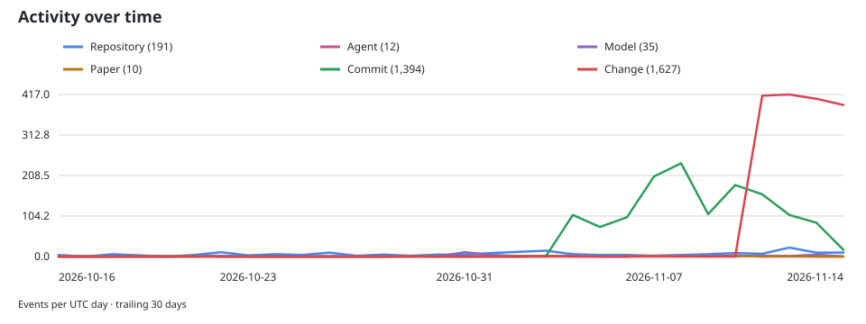

# RWKV Project Tracker

A daily summary of RWKV projects, model updates, agent projects, papers, and development activity.

**Last fetched:** 2026-11-13T12:24:08.985502Z · **[Complete JSON data](data.json)**

## Overview

| Type | Records | Complete Markdown list |
|---|---:|---|
| GitHub projects | 1,014 | [github.md](docs/github.md) |
| Model updates | 967 | [models.md](docs/models.md) |
| Agent projects | 47 | [agents.md](docs/agents.md) |
| arXiv papers | 147 | [papers.md](docs/papers.md) |

## Activity over time

Each line counts one activity category per UTC day over the trailing 30 days. [Daily series data](history/activity-daily.jsonl).

## Latest activity

The 25 most recent events across all sources. GitHub Pages shows the latest 100; the [activity JSONL](history/activity.jsonl) contains the complete derived feed.

| Date (UTC) | Type | Activity | Details |
|---|---|---|---|
| 2026-11-13 12:24 | Change | [zhiyuan8/RWKV-v7-7.2B-G0-GGUF](https://huggingface.co/zhiyuan8/RWKV-v7-7.2B-G0-GGUF) | Changed downloads · model · zhiyuan8/RWKV-v7-7.2B-G0-GGUF |
| 2026-11-13 12:24 | Change | [zhiyuan8/RWKV-v7-2.9B-World-v3-GGUF](https://huggingface.co/zhiyuan8/RWKV-v7-2.9B-World-v3-GGUF) | Changed downloads · model · zhiyuan8/RWKV-v7-2.9B-World-v3-GGUF |
| 2026-11-13 12:24 | Change | [zhiyuan8/RWKV-v7-2.9B-G1-GGUF](https://huggingface.co/zhiyuan8/RWKV-v7-2.9B-G1-GGUF) | Changed downloads · model · zhiyuan8/RWKV-v7-2.9B-G1-GGUF |
| 2026-11-13 12:24 | Change | [zhiyuan8/RWKV-v7-1.5B-World-v3-GGUF](https://huggingface.co/zhiyuan8/RWKV-v7-1.5B-World-v3-GGUF) | Changed downloads · model · zhiyuan8/RWKV-v7-1.5B-World-v3-GGUF |
| 2026-11-13 12:24 | Change | [zhiyuan8/RWKV-v7-1.5B-G1-GGUF](https://huggingface.co/zhiyuan8/RWKV-v7-1.5B-G1-GGUF) | Changed downloads · model · zhiyuan8/RWKV-v7-1.5B-G1-GGUF |
| 2026-11-13 12:24 | Change | [zhiyuan8/RWKV-v7-0.4B-World-v3-GGUF](https://huggingface.co/zhiyuan8/RWKV-v7-0.4B-World-v3-GGUF) | Changed downloads · model · zhiyuan8/RWKV-v7-0.4B-World-v3-GGUF |
| 2026-11-13 12:24 | Change | [zhiyuan8/RWKV-v7-0.4B-G1-GGUF](https://huggingface.co/zhiyuan8/RWKV-v7-0.4B-G1-GGUF) | Changed downloads · model · zhiyuan8/RWKV-v7-0.4B-G1-GGUF |
| 2026-11-13 12:24 | Change | [zhiyuan8/RWKV-v7-0.1B-G1-GGUF](https://huggingface.co/zhiyuan8/RWKV-v7-0.1B-G1-GGUF) | Changed downloads · model · zhiyuan8/RWKV-v7-0.1B-G1-GGUF |
| 2026-11-13 12:24 | Change | [zhiyuan8/RWKV-v6-7B-World-v3-GGUF](https://huggingface.co/zhiyuan8/RWKV-v6-7B-World-v3-GGUF) | Changed downloads · model · zhiyuan8/RWKV-v6-7B-World-v3-GGUF |
| 2026-11-13 12:24 | Change | [zhiyuan8/RWKV-v6-3B-World-v2.1-GGUF](https://huggingface.co/zhiyuan8/RWKV-v6-3B-World-v2.1-GGUF) | Changed downloads · model · zhiyuan8/RWKV-v6-3B-World-v2.1-GGUF |
| 2026-11-13 12:24 | Change | [zhiyuan8/RWKV-v6-1.6B-World-v2.1-GGUF](https://huggingface.co/zhiyuan8/RWKV-v6-1.6B-World-v2.1-GGUF) | Changed downloads · model · zhiyuan8/RWKV-v6-1.6B-World-v2.1-GGUF |
| 2026-11-13 12:24 | Change | [zhaojiangshan2010/RWKV-Easy](https://github.com/zhaojiangshan2010/RWKV-Easy) | Changed stars, updated_at · repository · zhaojiangshan2010/RWKV-Easy |
| 2026-11-13 12:24 | Change | [yashmahe2018/vanilla-skip-rwkv7-strict-small-babylm2026](https://huggingface.co/yashmahe2018/vanilla-skip-rwkv7-strict-small-babylm2026) | Changed downloads · model · yashmahe2018/vanilla-skip-rwkv7-strict-small-babylm2026 |
| 2026-11-13 12:24 | Change | [yashmahe2018/rwkv7-halfclm-strict-small](https://huggingface.co/yashmahe2018/rwkv7-halfclm-strict-small) | Changed downloads · model · yashmahe2018/rwkv7-halfclm-strict-small |
| 2026-11-13 12:24 | Change | [xiaol/rwkv-novel-agent-g1h-13b-ctx10240](https://huggingface.co/xiaol/rwkv-novel-agent-g1h-13b-ctx10240) | Changed downloads · model · xiaol/rwkv-novel-agent-g1h-13b-ctx10240 |
| 2026-11-13 12:24 | Change | [xiaol/gemma-4-e4B-hybrid-rnn-mem-rwkv-fable5-gpt5.5-v1-GGUF](https://huggingface.co/xiaol/gemma-4-e4B-hybrid-rnn-mem-rwkv-fable5-gpt5.5-v1-GGUF) | Changed downloads · model · xiaol/gemma-4-e4B-hybrid-rnn-mem-rwkv-fable5-gpt5.5-v1-GGUF |
| 2026-11-13 12:24 | Change | [xiaol/RWKV-v4-raven-14B-one-state](https://huggingface.co/xiaol/RWKV-v4-raven-14B-one-state) | Changed downloads · model · xiaol/RWKV-v4-raven-14B-one-state |
| 2026-11-13 12:24 | Change | [xiaol/Huggingface-RWKV-claude-for-mobile-v4-world-1.5B-16k](https://huggingface.co/xiaol/Huggingface-RWKV-claude-for-mobile-v4-world-1.5B-16k) | Changed downloads · model · xiaol/Huggingface-RWKV-claude-for-mobile-v4-world-1.5B-16k |
| 2026-11-13 12:24 | Change | [win10/RWKV7-G1j-10B-A1B](https://huggingface.co/win10/RWKV7-G1j-10B-A1B) | Changed downloads · model · win10/RWKV7-G1j-10B-A1B |
| 2026-11-13 12:24 | Change | [win10/Gemma4-HRM-RWKV-7-Untrained](https://huggingface.co/win10/Gemma4-HRM-RWKV-7-Untrained) | Changed downloads · model · win10/Gemma4-HRM-RWKV-7-Untrained |
| 2026-11-13 12:24 | Change | [win10/Gemma4-HRM-RWKV-7-5B-Token](https://huggingface.co/win10/Gemma4-HRM-RWKV-7-5B-Token) | Changed downloads · model · win10/Gemma4-HRM-RWKV-7-5B-Token |
| 2026-11-13 12:24 | Change | [wenda-LLM/wenda](https://github.com/wenda-LLM/wenda) | Changed stars, updated_at · repository · wenda-LLM/wenda |
| 2026-11-13 12:24 | Change | [wangyue114514/rwkv7-g1g-7.2b-hf](https://huggingface.co/wangyue114514/rwkv7-g1g-7.2b-hf) | Changed downloads · model · wangyue114514/rwkv7-g1g-7.2b-hf |
| 2026-11-13 12:24 | Change | [wangyue114514/rwkv7-g1g-13.3b-hf](https://huggingface.co/wangyue114514/rwkv7-g1g-13.3b-hf) | Changed downloads · model · wangyue114514/rwkv7-g1g-13.3b-hf |
| 2026-11-13 12:24 | Change | [wangyue114514/rwkv7-g1d-0.4b-hf](https://huggingface.co/wangyue114514/rwkv7-g1d-0.4b-hf) | Changed downloads · model · wangyue114514/rwkv7-g1d-0.4b-hf |

## Main model

Tracked model: [BlinkDL/rwkv7-g1](https://huggingface.co/BlinkDL/rwkv7-g1).

- Source repository last changed: **2026-11-04**.
- Latest observed `new model` commit: **2026-10-31**.
- `new model` commit within 31 days: **yes**.
- Newest date embedded in a current checkpoint filename: **2026-10-31**.

The 31-day indicator describes observed commit titles, not a guaranteed release schedule.

## Activity history

GitHub Pages includes auto-updating charts for project totals, daily commits, project changes, and arXiv first submissions.

Raw history: [activity](history/activity.jsonl) · [daily counts](history/daily.jsonl) · [project changes](history/changes.jsonl) · [commits](history/commits.jsonl) · [papers](history/papers.jsonl).

Commit collection begins **2026-11-04** and extends daily. Commits are observed on default branches. Project-count history begins with the first daily snapshot; earlier counts are never fabricated.

Hugging Face results are matching model repositories, not independently verified weights. arXiv results mention RWKV in their title or abstract; publication dates mean first arXiv submission, not journal publication.
